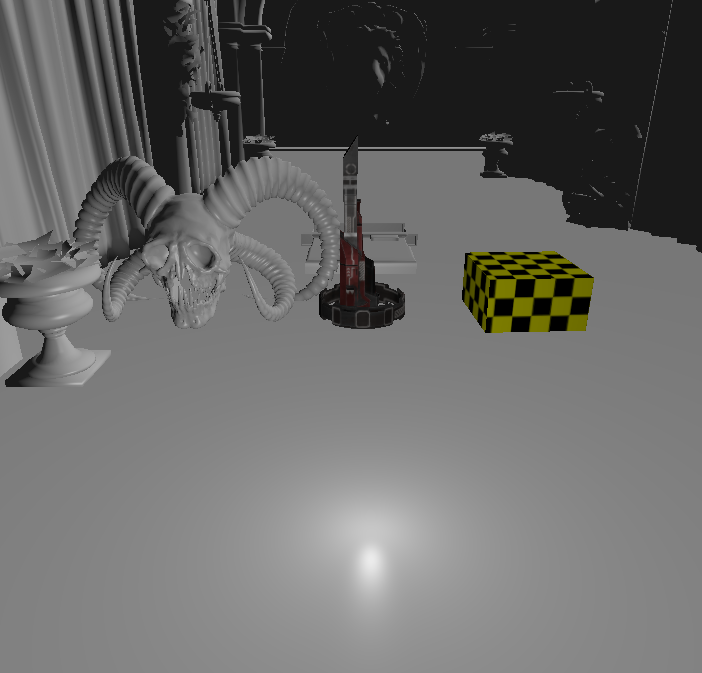
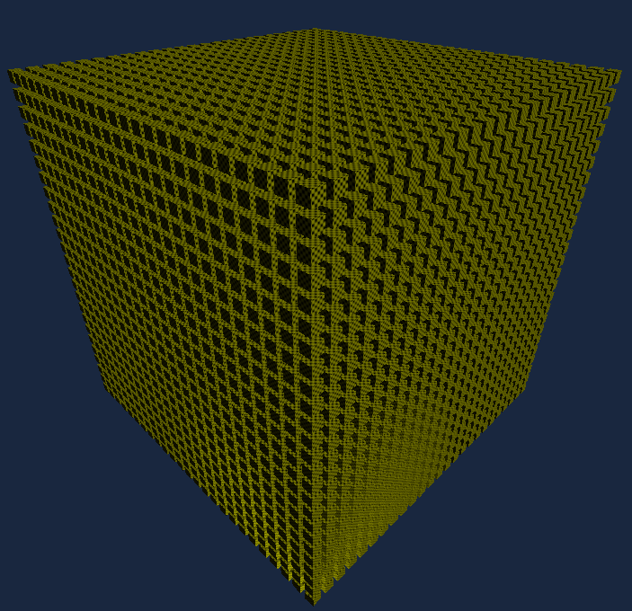

# FSEngine
Vulkan based game engine made in C++

# current status
- specular lighting

- 15625 non-instanced cubes running at 144 FPS

- full vulkan graphics pipeline
- specular and diffuse lighting (blinn-phong)
- using stb_image for texture loading
- using my own maths utilities
- using my own windowing library (windows + linux (x11) only)
- WASD camera system
- hardcoded lights
- BLOB Entity
- SSBO to send entity orientation
- MultiDrawIndirect to draw
- Vulkan is tightly coupled with the engine

# todo

- Add MSAA
- support glTF and better lighting 
- decouple the engine from the rendering API 
- and maybe have software + vulkan + other apis as one click/line change
- also decouple the engine from the game
- implement my own ECS
- have some ui maybe