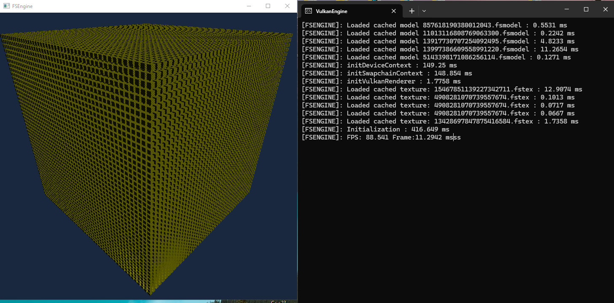

# FSEngine
Vulkan based game engine made in C++

## Screenshots
- specular lighting

- 97,336 non-instanced cubes running at ~60-70+ FPS while being updated every frame

## Building Requirements:
Vulkan : 1.4 
Slangc : 2025.0+ 
Platform : Windows or Linux 
CMake : 3.10+ 

## Controls
WASD - move 
Arrow keys/Mouse - rotate 
G - lock-unlock mouse 

## current status

- full vulkan graphics pipeline
- specular and diffuse lighting (blinn-phong)
- using stb_image for texture loading
- using my own maths utilities
- using my own windowing library (windows + linux (x11) only)
- WASD camera system
- SSBO to send entity orientation
- MultiDrawIndirect to draw

## todo

- remove hardcoded lights
- support glTF and better lighting 
- decouple the engine from vulkan
- decouple the engine from the game
- implement ECS
- have software + vulkan + other apis as one click/line change
- Add MSAA
- have some ui maybe